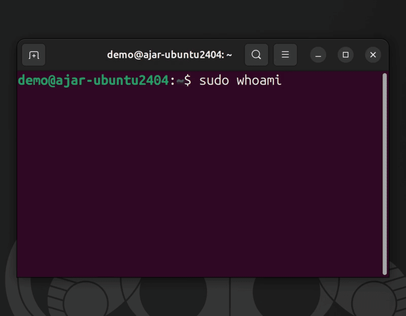
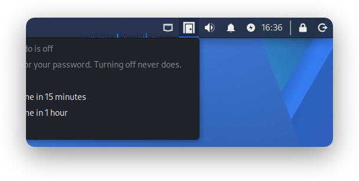
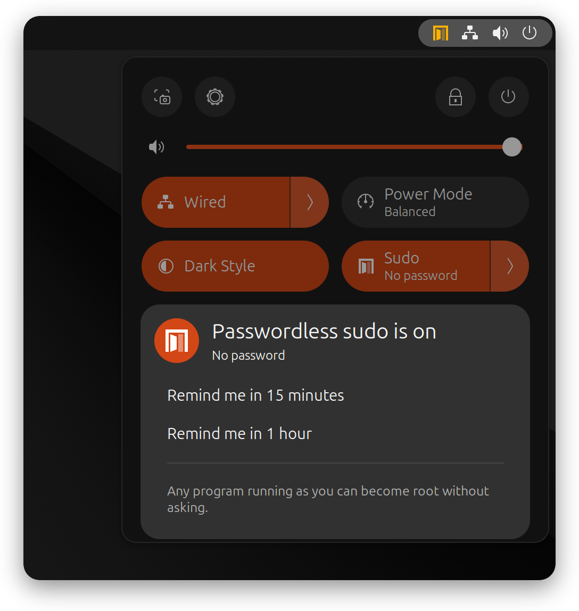
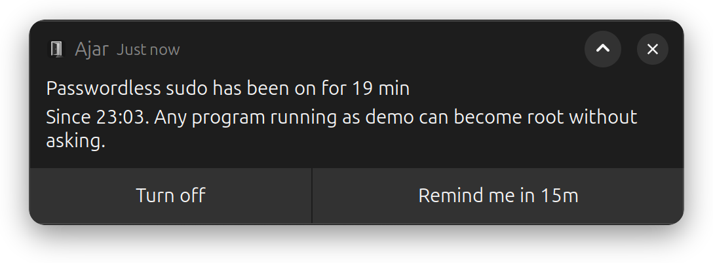

<p align="center">
  
</p>

<h1 align="center">Ajar</h1>

<p align="center"><b>Leave sudo open on purpose, and close it in one click.</b><br>
A switch for passwordless sudo on Linux desktops: GNOME, Xfce, KDE and the command line.</p>

<p align="center">
  <a href="https://github.com/techbysakh963/ajar/actions/workflows/ci.yml"></a>
  <a href="https://github.com/techbysakh963/ajar/releases/latest"></a>
  <a href="LICENSE"></a>
</p>

<p align="center"></p>

You are about to run twenty `sudo` commands, or an AI agent is about to run them for you.
Typing your password twenty times is pointless; leaving `NOPASSWD` in your sudoers forever is
worse. **Ajar** is the middle ground:

- **On** — sudo stops asking. An **amber door** sits in your top bar for as long as it lasts.
- **Off** — sudo asks again. One click, no password, instant.
- Turning on **always** asks for your password (polkit). Nothing can turn it on behind your back.
- Optional reminder: *"Passwordless sudo has been on for 30 min"* with a **Turn off** button.

## Screenshots

| GNOME (Ubuntu, Debian) | Xfce (Kali) |
|---|---|
|  |  |
|  |  |

All screenshots are from real desktops, not mock-ups: GNOME Shell 50 (Ubuntu 26.04),
GNOME 48 (Debian 13), Xfce (Kali rolling). See [screenshots/README.md](screenshots/README.md).

## Install

**Debian, Ubuntu, Kali** — the package (recommended):

```bash
curl -fsSLO https://github.com/techbysakh963/ajar/releases/latest/download/ajar_1.0.0_all.deb
sudo apt install ./ajar_1.0.0_all.deb
```

**Or the installer** (shows every change and asks before making it):

```bash
curl -fsSL https://github.com/techbysakh963/ajar/releases/download/v1.0.0/install.sh | bash
```

| Option | |
|---|---|
| `--dry-run` | show the plan, change nothing |
| `--yes` | do not ask (scripts, provisioning) |
| `--lockdown` | also remove *other* passwordless grants for you (see below) |
| `--uninstall` | remove everything it installed |

The release `install.sh` contains the SHA-256 of its tarball and refuses anything else; a
truncated download runs nothing. Prefer to read first? `curl -fsSLO …/install.sh`, read it,
`bash install.sh`.

**On GNOME (Wayland), log out and back in once** after installing. GNOME cannot load a new
extension into a running session. Then find **Sudo** in Quick Settings.

## Use

| | GNOME 45 – 50 | Xfce, KDE, MATE, Cinnamon, GNOME 43/44 | Terminal |
|---|---|---|---|
| Turn on | Quick Settings → **Sudo** | tray door → **Turn on** | `ajar on` |
| …with a reminder | **Sudo** ▸ → *remind me in 15 minutes* | tray → *Turn on, remind me in…* | `ajar on --remind 30m` |
| Turn off | click **Sudo** again | tray → **Turn off** (or middle-click) | `ajar off` |
| What is the real state? | the icon | the icon | `ajar status` |

```console
$ ajar status
ON: sudo runs without a password for sam.
  Reminder: 2026-11-09T15:42:00+03:00
$ ajar doctor        # explains anything unusual: missing pkexec, no polkit agent, other rules…
$ journalctl -t ajar # every change, with time and user
```

## How it works

```
 GNOME toggle ─┐
 tray icon ────┼──> ajar (CLI) ──> pkexec ──> polkit: password? ──> /usr/libexec/ajar/enable
 terminal ─────┘        │                                            writes /etc/sudoers.d/90-ajar-<you>
                        └──> sudo -n -l   (the real state, asked of sudo itself)
```

- **One file is the whole state.** On = `/etc/sudoers.d/90-ajar-<you>` exists; off = it does not.
  It is checked with `visudo` before sudo can see it, and swapped in atomically.
- **The state you see comes from sudo**, never from a saved flag. If something else already
  gives you passwordless sudo, Ajar says so (*"open by another rule"*) instead of pretending.
- **polkit decides.** Turning on is `auth_admin` everywhere. Turning off is free only for the
  user at the machine (active local session); SSH sessions must authenticate.
- **Only two short scripts run as root.** Everything else runs as you.

Full threat model, including what Ajar does **not** protect: **[SECURITY.md](SECURITY.md)**.

## Supported

| Distribution | Desktop | Front end | Tested |
|---|---|---|---|
| Ubuntu 26.04 | GNOME 50 | Quick Settings toggle | real desktop |
| Ubuntu 24.04 | GNOME 46 | Quick Settings toggle | VM |
| Debian 13 | GNOME 48 | Quick Settings toggle | VM |
| Debian 12 | GNOME 43 | tray (needs the AppIndicator extension) | VM |
| Kali rolling | Xfce | tray | VM |
| all of the above | none (server) | `ajar` CLI | containers, every commit |

sudo 1.9.13 – 1.9.17 and **sudo-rs** (Ubuntu 26.04) are supported. Other Debian-based
distributions and desktops with a system tray should work; please
[report how it goes](https://github.com/techbysakh963/ajar/issues/new/choose).

## FAQ

**Why not just `NOPASSWD` in sudoers?** Because you forget it is there. Ajar makes the open
state visible (amber door), temporary by habit (one click to close), and reminds you.

**Does it turn itself off after N minutes?** No, on purpose. A package upgrade or an AI agent
that loses sudo mid-task can leave your system half-configured. The reminder *asks* you
instead. See [SECURITY.md](SECURITY.md#what-ajar-does-not-protect).

**I enabled Kali's passwordless sudo (`kali-grant-root`). Does Ajar notice?** Yes: it shows
*"open by another rule"*. A stock Kali install asks for a password; the opt-in
(`sudo dpkg-reconfigure kali-grant-root` → enable) puts every `sudo` member into the
`kali-trusted` group. `install.sh --lockdown` takes you out of that group so Ajar is the only
switch (it refuses if that would leave you without working sudo). Choosing *enable* in
`dpkg-reconfigure kali-grant-root` again later puts you back.

**Debian says "pkexec: command not found".** Debian 12+ ships it separately:
`sudo apt install pkexec` (the `.deb` pulls it in for you).

**I clicked and nothing asked for my password (Xfce, LXDE…).** No polkit agent is running.
`ajar doctor` tells you; `sudo apt install policykit-1-gnome` fixes it on most desktops.

**I use sudo over SSH.** Turning on from SSH asks for the password in the terminal. Turning
off from SSH also asks, by design: only the person at the machine can close it for free.

**Is this safe for AI agents?** It is *honest* for AI agents: while it is on, the agent is
root, exactly as if you had typed your password for it. Turn it on for the task, watch the
amber door, turn it off after.

## Uninstall

```bash
ajar uninstall          # script install: turns sudo back to normal first, removes every file
sudo apt remove ajar    # package install: same
```

## Contributing

Bug reports with `ajar doctor` output are gold. See [CONTRIBUTING.md](CONTRIBUTING.md); one
rule matters above all: no test may ever turn Ajar on through the real password dialog.

MIT licensed. Made by [@techbysakh963](https://github.com/techbysakh963).
